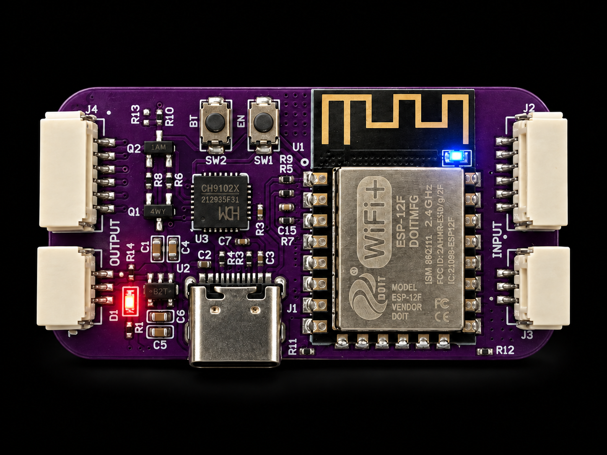

# NexusOwie



NexusOwie combines the Owie firmware with the custom Owie12FV3 ESP-12F interface board.

## PCB files

- `Owie12FV3/` contains the KiCad schematic, PCB layout, project configuration, render, BOM, component positions, netlist, and fabrication ZIP.
- `Owie12FV3 Panel 2x3/` contains the KiCad 2×3 production panel and panel fabrication files.

Open `Owie12FV3/Owie12FV3.kicad_pro` in KiCad to edit the board.

## Firmware

The firmware is a PlatformIO project. Build it with:

```sh
pio run
```

## Safety

This is an unaffiliated hobby project provided without warranty. Working on battery systems can cause equipment damage, fire, serious injury, or death. Verify the design and fabrication outputs independently before manufacturing or installation.
